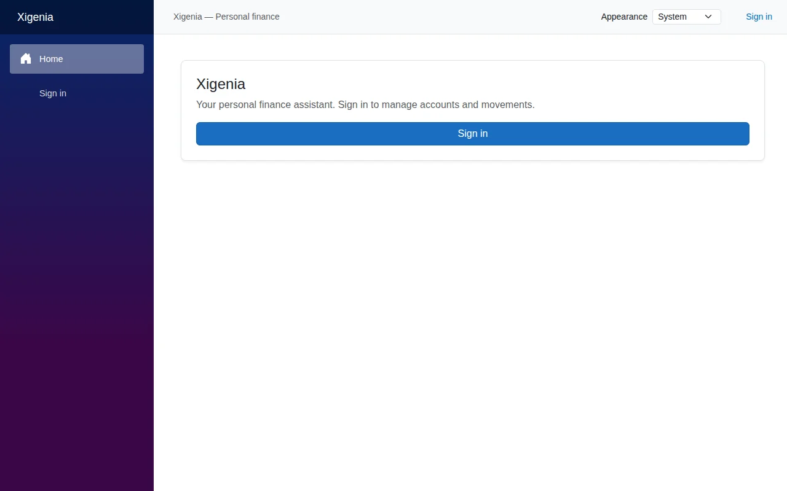
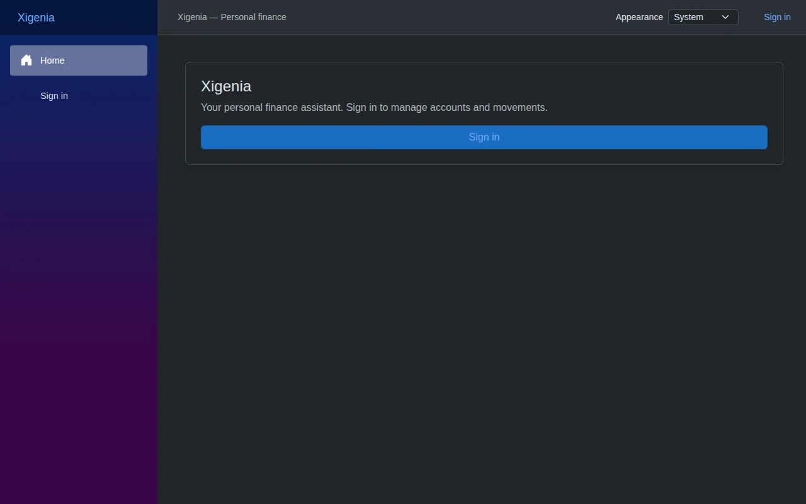
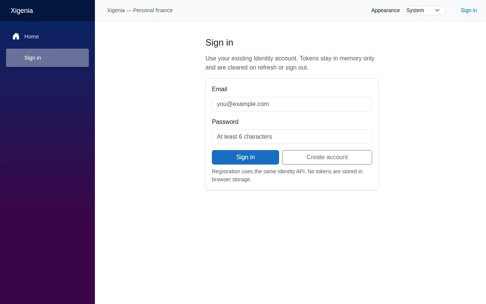
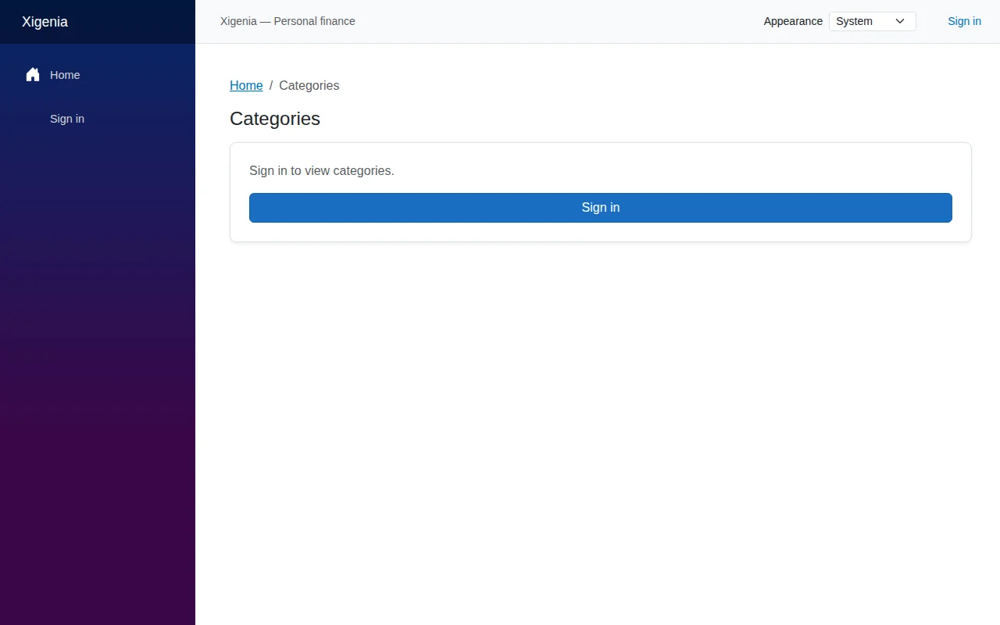
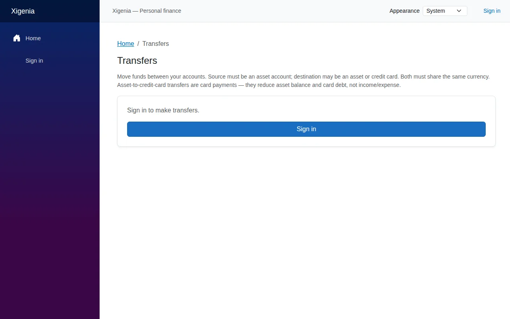
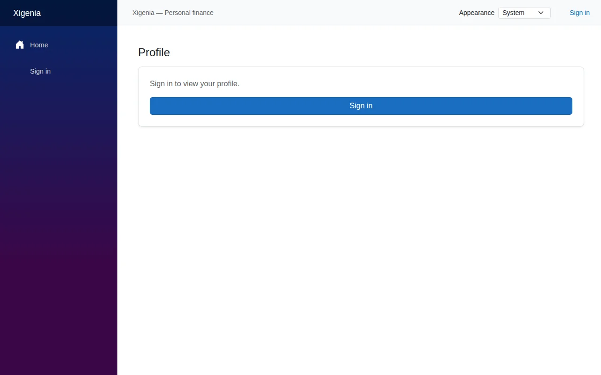
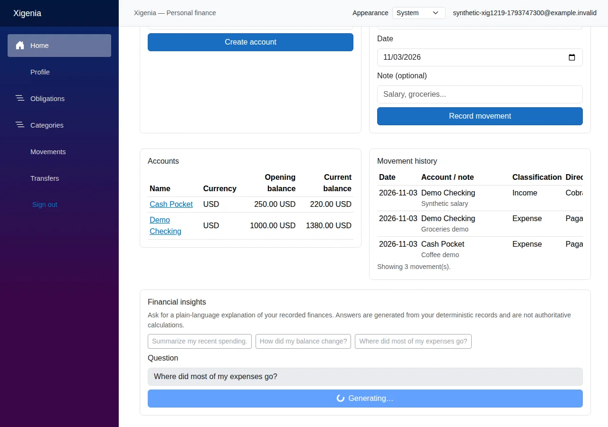
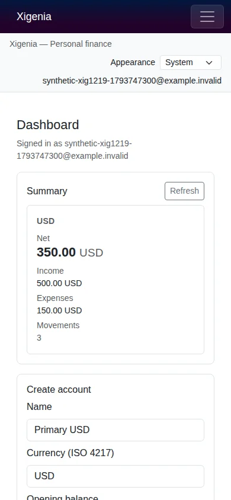
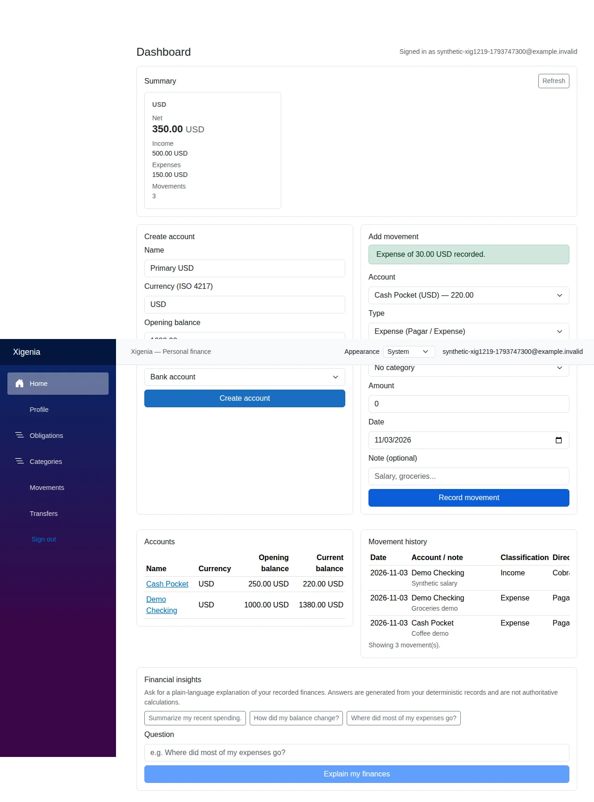

# Xigenia

**Open Source Personal Finance, Powered by Meta AI**

You record your money — Xigenia keeps the math honest and lets Meta AI explain it in plain language. Every balance is calculated deterministically from your entries; the AI never touches the ledger, it just helps you understand what you already recorded.

**Web:** https://xigenia.sparsa.dev · **API:** https://api.xigenia.sparsa.dev · **Source:** https://github.com/sparsadev/xigenia · **Demo:** https://www.youtube.com/@sparsadev

**License:** No open-source license file is present yet. The source is publicly visible at the URL above; the specific license is to be decided by the Project Owner and is not asserted here.

## See it in action

All captures below are genuine screenshots of the current local build at `http://localhost:5096` on November 3, 2026 — no mockups. Signed-out views contain no personal data; no accounts or transactions were created for these captures.

| Home — desktop, light | Home — desktop, dark | Home — mobile |
|---|---|---|
|  |  |  |

*Light, dark and responsive shell. Appearance is stored as `xigenia.appearance` and applied before styles load; System follows the OS.*

| Sign in | Categories | Transfers |
|---|---|---|
|  |  |  |

| Movements | Obligations | Profile |
|---|---|---|
|  |  |  |

Protected pages show a signed-out guard (for example, *"Sign in to make transfers."*) and never expose financial data without authentication. Captured at 1280×800 (home also at 390×844); images are WebP rendered by Playwright 1.64.1 in an isolated browser context.

### Authenticated experience — synthetic data

Genuine captures of a controlled synthetic session in `XigeniaDev` on Antares. Identity `synthetic-xig1219-...@example.invalid` with fictional records only — no real user data.

| Dashboard — desktop (authenticated) | Dashboard — mobile (authenticated) |
|---|---|
|  |  |

*Balances and history are deterministic: Demo Checking USD 1000 → 1380 after USD 500 income and USD 120 expense; Cash Pocket USD 250 → 220 after USD 30 expense; summary Net 350, Income 500, Expenses 150, Movements 3. Financial insights request issued; response remained Generating… at capture time and is not shown as completed. The disclaimer and non-authoritative labeling remain visible in the UI.*

Full authenticated capture: 


### Historical reference

Earlier synthetic screenshots (`assets/showcase/dashboard-desktop.png`, `dashboard-mobile-authenticated.png`, `empty-owner-mobile.png`, `financial-insights-success.png`, `login-desktop.png`) are retained for context. They predate the current shell and are not used above.

## What can Xigenia help you do?

- **Get started in seconds** — register, sign in, and see a clear home with guidance instead of a blank slate.
- **Create accounts** for cash, bank, and digital wallets — one currency per account with an opening balance.
- **Record income and expenses** with amount, date, account, and an optional note.
- **Move money between your own accounts** and **track obligations** with settlements — all validated and owner-scoped.
- **Organize with categories**, including a seeded global catalog.
- **Review balances and summaries** per currency: income, expenses, net, movement counts, and current balances — no cross-currency totals or hidden conversions.
- **Inspect movement history** newest first, with direction separated from classification and account names resolved.
- **Manage your profile** — change password or request an email change with explicit confirmation.
- **Stay oriented** with loading, empty, and error states that explain what happened and what to do next.

What it does not yet do in the UI: importing bank statements, budgeting or goals, recurring rules, interest automation, cross-currency transfers, or charting. The API already implements categories, transfers and obligations at the endpoint level; the dashboard surfaces the core loop above.

## Understand your finances with Meta AI

Meta is the explainer, never the bookkeeper.

- Uses the **Meta Model API (Standard)** — `muse-spark-1.3` at `https://api.meta.ai/v1/` via `chat/completions` (non-streaming, `max_tokens` 10000, `reasoning_effort` low, 30 s timeout, all configurable).
- **Your context, assembled in C#** — on each request the API gathers your account balances, per-currency summaries, category aggregates, and bounded recent movements (capped at 1,000 movements, 6,000-character context budget). The dashboard sends only your question; filters like date/account exist at the API level.
- **Grounded and labeled** — the model is instructed to use only the supplied figures, separate facts from suggestions, and every response carries provider/model metadata, timestamps, `isAuthoritativeFinancialCalculation: false`, and a non-authoritative disclaimer.
- **No hands on the ledger** — the model has no database access and no write tools; its text is displayed and never saved as financial records.
- **Honest about limits** — missing config returns 503, upstream or incomplete aggregation returns sanitized errors, timeouts map to 504. Oversized context is truncated or rejected explicitly; not every record necessarily reaches the model.

This is not a vector-database search, model training, bank sync, or autonomous advice — it is deterministic computation plus a plain-language explanation you can check against the numbers.

## Built for real people

- **Readable by default** — summary first, clear two-decimal amounts grouped by currency, consistent hierarchy.
- **Accessible foundations** — skip-to-content, labelled tables, focusable history region, navigation `aria-expanded`/`aria-controls`, meaningful busy and status messaging. Full keyboard, screen-reader, zoom and contrast acceptance remains deferred — these are foundations, not a conformance claim.
- **Light, dark, and system** — applied before paint, remembered when browser storage is available, System follows OS changes. Blocked storage still allows switching for the current session.
- **Responsive** — stacking grids and local table scrolling at 1280, 641 and 360 px widths (see captures). No horizontal page overflow in the inspected shell.
- **Careful sessions** — tokens live in memory only and clear on reload or sign-out; stale responses are rejected by session-version checks, and uncertain writes stay locked until you reconcile and explicitly confirm.

## Explore Xigenia

- **Live Web:** https://xigenia.sparsa.dev
- **Live API health:** https://api.xigenia.sparsa.dev/health
- **Source:** https://github.com/sparsadev/xigenia
- **Demo video channel:** https://www.youtube.com/@sparsadev

Deployed topology (reported, not re-verified here): Cloudflare HTTPS → Tunnel on Andromeda → Nginx Proxy Manager on Vega → Prometheus (`192.168.10.149`, `xigenia-deploy`) → SQL Server on Antares. Deployed commit and image digests remain unverified.

## Run it yourself

### Local development

Requires .NET 10 SDK (see `global.json`) and an already provisioned SQL Server development database you are authorized to use. Never commit credentials or paste connection strings into issues or screenshots.

```bash
# 1. Configure the API database connection privately
dotnet user-secrets set "ConnectionStrings:DefaultConnection" "YOUR_CONNECTION_STRING" --project src/Xigenia.Api

# 2. Run API and Web in separate terminals (Release http profiles)
dotnet run --project src/Xigenia.Api/Xigenia.Api.csproj --configuration Release --launch-profile http
dotnet run --project web/Xigenia.Web/Xigenia.Web.csproj --configuration Release --launch-profile http
```

- API: `http://localhost:5122` · Web: `http://localhost:5096` (CORS allows the local Web origin).
- `GET http://localhost:5122/health` checks the API process, not database health.
- API startup reads the global category catalog and may insert missing fixed-ID categories under a transaction — it does not run migrations or create the database.
- Frontend reads `ApiBaseUrl` from configuration; confirm it points to your API. Use your own account; tokens clear on reload.

### Docker (local evaluation)

```bash
cp .env.example .env
# set SA_PASSWORD and optionally META_AI_API_KEY in .env
docker compose up --build
```

App at `http://localhost:8081`, health at `http://localhost:8080/health`. Compose does not apply EF Core migrations — the schema must already be provisioned from `src/Xigenia.Api/Data/Migrations`. The deploy composition (`docker-compose.deploy.yml`, `web/Xigenia.Web/nginx.conf`, `.dockerignore`, `.env.deploy.example`) differs: external SQL Server, separate origins, `API_BASE_URL=https://api.xigenia.sparsa.dev` baked at build time, and SPA fallback via nginx. Build tags: `xigenia-web:deploy` and `xigenia-api:deploy` (images not built here).

## How it works

```
Browser / Blazor WebAssembly → ASP.NET Core API (Identity, EF Core) → Application/Domain → SQL Server
                                          ↘ bounded context → Meta AI → non-authoritative explanation
```

- **Domain** — financial entities, `Money` value type, invariants.
- **Application** — `FinanceService`, rules, `IFinanceStore` contracts.
- **API** — endpoints, Identity, `EfFinanceStore`, global category initializer.
- **Infrastructure** — Meta provider configuration and HTTP client.
- **Web / Shared** — Blazor frontend and shared components.

Key choices: `decimal` with two places matches `decimal(18,2)` storage and avoids a separately stored balance; ISO 4217 currency normalization with per-currency summaries; direction separate from classification; owner derived server-side; check constraints and serializable transactions on relevant writes (practice, not a proof of full concurrency or compliance).

## Privacy, transparency, and current limitations

- Records are **user-entered**, not bank-verified — Xigenia explains recorded finances.
- **No real data was used** for these screenshots or for model calls in this task; synthetic fixtures only where prior evidence notes them.
- Provider credentials never leave server configuration; finance and AI routes require authentication; queries are owner-scoped.
- AI output is **non-authoritative** — always compare it with the deterministic balances shown alongside it.

**Known limits:** `NoOpEmailSender` prevents end-to-end email confirmation; token revocation after password change is unverified; mixed-direction obligation aggregation sums regardless of direction; `W-1130-01` stale-loader feedback race remains open; browser/keyboard/screen-reader and full responsive acceptance, complete SQL coverage, and production hardening are deferred. Prior test counts (e.g., 352 unit tests in C5.6.2, 45/45 Razor, 9/9 R6, etc.) are historical and not re-run here.

## Meta Global AI Developer Hackathon 2026

Built for the **Indie category** — a focused, open-source MVP that demonstrates a genuine Meta AI integration: deterministic financial computation where it must be exact, and Meta AI where plain language helps people act on their own numbers. No fabricated totals, no bank connections, no autonomous transactions — just your recorded finances, explained clearly.
