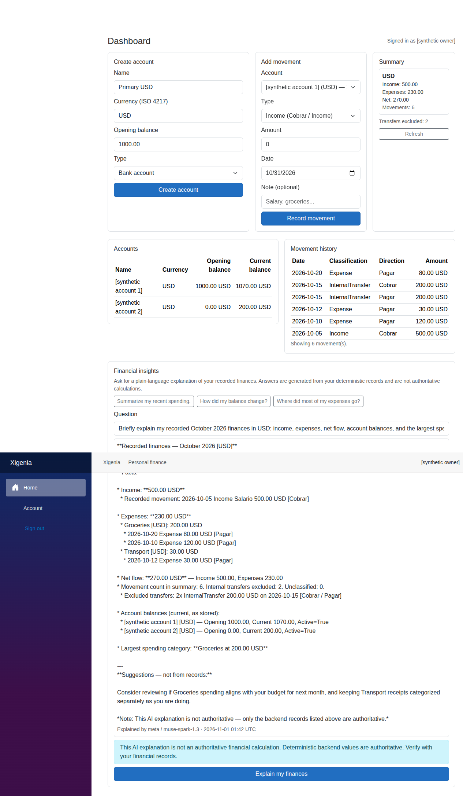
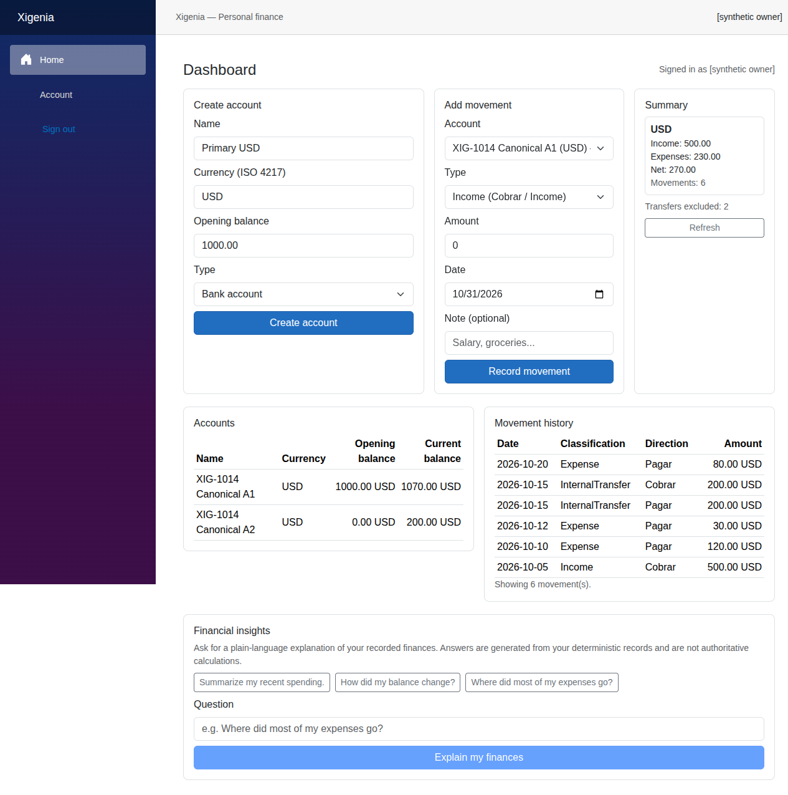
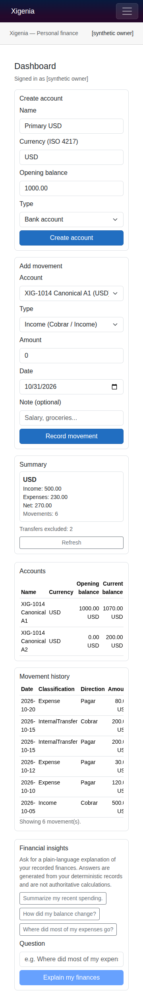
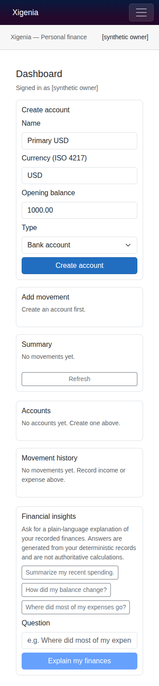
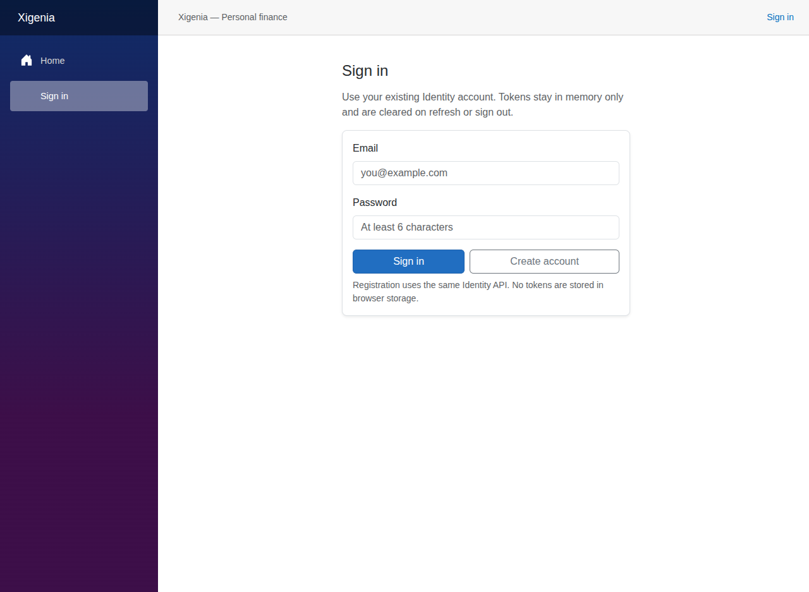

# Xigenia

**Open Source — Understand where your money goes — with plain-language explanations powered by Meta AI.**

**Web:** https://xigenia.sparsa.dev · **API:** https://api.xigenia.sparsa.dev · **Source:** https://github.com/sparsadev/xigenia · **Demo:** https://www.youtube.com/@sparsadev

**License:** No open-source license file is present in this repository yet. The source is publicly visible at the GitHub URL above; the specific open-source license is to be decided by the Project Owner and is not asserted here.

Xigenia is a personal-finance MVP built for the **Meta Global AI Developer Hackathon 2026 (Indie category)**.
In one sentence: **Xigenia calculates your recorded finances; Meta helps explain them.** The backend computes
every figure deterministically from records you entered, and Meta turns those figures into readable language
without ever touching the books.

## Evaluate in brief

- Run it locally with Docker: app at `http://localhost:8081`, API health at `http://localhost:8080/health`.
- For .NET development, run the API at `http://localhost:5122` and the frontend at
  `http://localhost:5096`; see [development startup](#development-startup).
- Deployment addresses are `https://xigenia.sparsa.dev/` and
  `https://api.xigenia.sparsa.dev/health`. An existing authenticated public browser tab was observed,
  but it displayed an older UI. Its deployed revision and general Internet availability were not verified here.
- No demo video is included. The [gallery](#see-the-experience) distinguishes current signed-out captures
  from historical screenshots with sanitized synthetic data.

## The everyday financial problem

Statements and transaction lists show what moved, but they do not explain spending patterns or why a cash
position changed. People managing personal or household money — earners, families, freelancers — are left to
do that interpretation themselves, and generic chatbots answer from guesswork instead of their books.

Xigenia exists to close that gap: explanations you can trace back to the recorded numbers. One honest
boundary applies throughout: the records are user-entered, not bank-verified data, so the product explains
*recorded* finances rather than independently verified financial truth.

## What the working experience offers

The signed-in dashboard covers one complete loop: register, create accounts, record income and expenses,
review balances and summaries, inspect history, and ask for an explanation.

- **Register and sign in** with email and password. Tokens live in memory only, and private views clear
  on sign-out, refresh, or session replacement.
- **Create asset accounts** for cash, bank accounts, and digital wallets — one currency per account
  with an opening balance.
- **Record income and expenses** with amount, date, account, and an optional free-text note.
- **Review opening and current balances** per account, plus income, expense, net, and movement counts
  grouped by currency.
- **Inspect classified movement history**, newest first, with cash-flow direction shown separately
  from economic classification, account names resolved by identifier, and safely encoded optional notes.
  Missing account context has explicit fallback labels; multiline notes retain their line breaks.
- **Ask Financial insights** questions such as "Where did most of my expenses go?" and read the answer
  next to a visible non-authoritative disclaimer.
- **Rely on careful session handling**: stale responses are rejected by session-version checks, and
  uncertain creation outcomes show explicit reconcile-or-confirm controls instead of risking duplicates.
- **Read the summary first**: Net, Income, Expenses and movement counts remain separate for each currency,
  with exact two-decimal amounts and no cross-currency conversion or aggregate total.
- **Use navigation/accessibility foundations**: skip-to-content entry, readable wrapping identity,
  navigation expanded/control semantics, labelled table headers and a named focusable history overflow region.
- **Choose Light, Dark or System appearance**. The controller applies the effective theme before styles/Blazor,
  remembers the preference when browser storage permits, and follows OS changes in System mode.
  Storage failures fall back gracefully; persistence is not guaranteed when storage is blocked.
- **Use responsive layout foundations**, including stacking grids, wrapping content and local table scrolling,
  with loading, empty and error feedback. Complete viewport, zoom, keyboard and assistive-technology acceptance
  remains deferred; these implementation details are not a claim of full mobile accessibility.

To avoid confusion: the dashboard has no category-management, category-assignment, transfer, obligation,
or settlement controls, and the movement note is free text rather than a structured category assignment.
The API additionally implements owner categories (including a seeded global catalog), same-owner
same-currency transfers, and obligations at the endpoint level; those are API capabilities, not dashboard
workflows.

## See the experience

### Current shell captures


*Captured from the running local frontend on November 3, 2026, at 1280 × 881. These contain no authenticated
identity or financial data. Light/Dark selection was observed in this shell; reload persistence and System/OS
interaction were not tested in this capture task. Screenshots do not establish contrast or accessibility acceptance.*

The local tab was signed out during capture. No registration or sign-in was performed for this task.
Current authenticated dashboard, summary-card and account/note screenshots are therefore unavailable here;
no private user records were copied and no synthetic records were created to manufacture a screenshot.
The running frontend's served build identity was not certified against the latest Release commit.

### Historical synthetic gallery

The images below are retained historical evidence, not screenshots of UI/UX Increments 1–4.
They predate the summary-first dashboard, appearance selector and account/note history column.
Their identities are sanitized and their financial examples are synthetic.




*Financial insights explaining recorded figures — income, expenses, net, largest category, stored balances —
with facts separated from suggestions and the non-authoritative disclaimer shown.*

A realistic demo path, in order:

1. Register and sign in.
2. Create an asset account with a synthetic opening balance.
3. Record synthetic income and expenses.
4. Inspect the opening/current balance, the per-currency summary, and the movement history.
5. Ask Meta to explain the same recorded finances.
6. Compare the explanation against the deterministic values and read the disclaimer.
7. Optionally record another expense and ask again to see the refreshed context.

An illustrative walkthrough with checkable arithmetic: open an account at USD 1,000.00, record USD 500.00
of income and expenses of USD 120.00 plus USD 30.00. The expected deterministic reads are a current balance
of USD 1,350.00, expenses of USD 150.00, and a net of USD 350.00. This is an illustration, not a test report.

The screenshots come from a separate historical fixture, so fresh UI entries will not reproduce their
categories or transfer history. That fixture's local live Meta example showed income USD 500.00, expenses
USD 230.00, net USD 270.00, current balances USD 1,070.00 and USD 200.00, Groceries USD 200.00 and transport
USD 30.00, and six movement rows including the two legs of one USD 200.00 transfer, with transfers excluded
from income/expense totals, facts separated from suggestions, and the explicit disclaimer. This is described
as a prior local demonstration with synthetic data, not as current validation. Note that model Markdown
markers currently display as plain text rather than rich formatting.



*The authenticated dashboard: account creation, movement entry, per-currency summary, accounts and history
tables, and Financial insights.*



*The same dashboard at phone width. Prior browser evidence covers a 360 px layout and selected
keyboard/label checks, not every device or workflow.*



*First run: empty states guide a new owner to create their first account.*



*Sign-in uses the Identity API; tokens stay in memory and never touch browser storage.*

## Why Meta AI matters

Meta is the explainer, never the bookkeeper — and the engineering makes that separation real.

- **Official Meta Model API (Standard).** The backend calls `muse-spark-1.3` at
  `https://api.meta.ai/v1/` through `chat/completions`. Defaults are non-streaming output,
  `max_tokens` 10000, `reasoning_effort` low, and a 30-second timeout. These are configurable
  defaults, not measured latency or production-tuning proof.
- **Authenticated, owner-scoped context.** `POST /api/ai/financial-explanation` requires sign-in, takes
  the owner identity from the server principal, and assembles context in C#: account balances,
  per-currency summaries, category expense aggregates, and bounded recent movements. The endpoint accepts
  optional date/account filters at the API level; the dashboard itself exposes only the question field.
- **Bounded and honest about bounds.** Financial aggregation is capped at 1,000 movements, account and
  category entries are capped, and the assembled context has a nominal 6,000-character budget with optional
  detail truncated first. Oversized or incomplete aggregation returns explicit recoverable errors instead
  of being labeled complete. Not every account, category, or transaction necessarily reaches the model.
- **Grounded by instruction, labeled in output.** The model is asked to use only the supplied figures,
  distinguish recorded facts from suggestions, and label its output non-authoritative. Each response carries
  model/provider metadata, timestamps, `isAuthoritativeFinancialCalculation: false`, and a disclaimer.
- **No hands on the ledger.** The model has no database access and no financial-write tools; its text is
  displayed as explanation and is never posted back as financial records.
- **Sanitized failures.** Missing server configuration returns 503, upstream and incomplete responses return
  sanitized errors, and timeouts map to 504 — never fabricated figures.
- **Explicit provider choice.** Meta and Baseten credentials are isolated with no automatic fallback.
  Baseten is an optional implementation path, not the demonstrated Meta story.

The differentiation is concrete: financial classification plus deterministic context assembly makes each
explanation specific to one owner's records, and newly recorded activity is reflected because the context
is rebuilt per request — while the model never becomes the calculator. The integration is designed to
ground explanations; prompt instructions alone are not presented as a guarantee against incorrect prose.
This is not retrieval over a vector database, model training or fine-tuning, bank synchronization,
autonomous financial advice, or an agent executing transactions.

## How it is engineered

Browser / Blazor WebAssembly → authenticated ASP.NET Core API → Application/Domain rules → EF Core /
SQL Server. Separately, the API sends bounded deterministic context to Meta and returns
a non-authoritative explanation.

Project responsibilities follow their names: Domain holds financial entities and invariants; Application
holds `FinanceService`, calculations, rules, contracts, and `IFinanceStore`; the API layer holds endpoints,
Identity, the EF Core context, and `EfFinanceStore`; Infrastructure holds Meta provider configuration,
the client factory, and HTTP integration; Web and Shared hold the frontend and shared components.

Selected decisions and their practical consequences:

- Money uses `decimal` arithmetic with at most two decimal places, matching `decimal(18,2)` storage, and
  balances are computed rather than stored as mutable state — avoiding a separately maintained balance that
  could diverge from recorded movements.
- Currency codes are normalized against an ISO 4217 allowlist with per-currency summaries.
- Cash-flow direction is modeled separately from economic classification, and internal transfers and linked
  settlements are excluded from income/expense totals.
- Ownership is derived server-side from the authenticated principal, finance and AI routes require
  authorization, provider credentials never leave server configuration, and persistence queries are
  owner-scoped.
- SQL check constraints guard amounts, classifications, transfer consistency, and card fields, and the
  store uses serializable transactions on relevant write paths. That is stated as implemented practice,
  not as proof of complete concurrency safety, audited security, compliance, or production readiness.

## Evaluate locally

### Development startup

Use a .NET 10 SDK compatible with `global.json` and an already provisioned, explicitly authorized SQL Server
development database. Configure `ConnectionStrings:DefaultConnection` privately through the API project's
.NET user-secrets provider or an approved environment mechanism. Never commit credentials or paste connection
strings into this README, screenshots, logs, or issue reports. Provider keys belong only in server configuration.

Confirm the effective database destination before startup. The API reads the global category catalog and may
insert missing fixed-ID categories under its existing transaction/application lock. It does not run EF migrations
or create the database automatically. Schema provisioning and any migration require separate authorization.

From the repository root, after dependencies and database permissions are ready:

```bash
dotnet run --project src/Xigenia.Api/Xigenia.Api.csproj --configuration Release --launch-profile http
dotnet run --project web/Xigenia.Web/Xigenia.Web.csproj --configuration Release --launch-profile http
```

Run these in separate terminals. The `http` profiles select Development, API `http://localhost:5122`, and frontend
`http://localhost:5096`. The frontend reads `ApiBaseUrl` from its configuration; confirm it points to the intended API.
Existing environment overrides can change effective configuration and must be checked rather than silently cleared.
The API allows the local frontend origin through CORS. A GET to `http://localhost:5122/health` checks API availability;
it does not certify database health or authentication correctness.

Use your own authorized account through the browser; no reusable credentials are supplied. Tokens are in memory,
so a reload clears the session. If registration/sign-in reports an uncertain outcome, do not assume success or
failure or automatically repeat registration. Reconcile the result before another write attempt.

### Docker topology (existing procedure)


Prerequisites: Docker for the composed topology, plus a Meta API key only for live explanations — without
one, the finance paths remain implemented and the explanation endpoint returns 503. The database schema
must already be provisioned from the bundled EF Core migrations; Docker Compose does not automatically
apply EF Core migrations.

Partial startup procedure from the inspected material (not a verified fresh-install procedure):

```bash
cp .env.example .env
# Set SA_PASSWORD in .env; optionally set META_AI_API_KEY.
docker compose up --build
```

Then open `http://localhost:8081` and check `http://localhost:8080/health`.

An important qualification: API startup seeds the global category catalog but does not apply database
migrations, and the inspected Compose files contain no schema-provisioning step. Do not treat the command
above as a verified fresh-install procedure — no verified clean-volume procedure was found in the
inspected material.
The deploy composition differs intentionally: separate frontend/API origins, an external SQL Server,
reversed host ports relative to local evaluation, and a frontend API base URL baked in at build time.
Its nginx SPA fallback is static configuration, not a fresh deep-link test.

## Evidence and current boundaries

### Current UI/UX technical gate

UI/UX Increments 1–4 and appearance assets are present at commit
`ecd3d7b5804636ed474dd21ba59b11975effa030`. The independent Increment 4 offline gate passed with warnings:
22 actual compiled-component display scenarios, 12 session/concurrency/uncertainty evidence records,
35 focused offline tests, and primary/isolated-snapshot Release builds with zero warnings/errors.
The committed tree matched the verified staged snapshot. These are recorded prior results, not tests rerun for
this README task, and they do not constitute final browser or usability approval.

**W-1130-01 remains open:** a stale prior-session loader cleanup can briefly change the new session's
loading/unavailable feedback. The exercised session confidentiality and refresh-ownership safeguards passed;
the feedback race itself was not fixed.

Full browser/keyboard/screen-reader, responsive visual, zoom, computed-contrast and real-browser appearance
persistence acceptance remains deferred to the consolidated Project Owner review. Current shell screenshots
are preliminary visual observations only. The current public tab showed an older dashboard, so it is not
used as evidence of the latest local implementation or deployment identity.

### Historical evidence

Recorded prior executions (not tests run for this README task, and from differing candidates and
environments, so their counts must not be combined or read as current-tree validation): 25/25 local
financial-core HTTP checks including totals and cross-owner denial; canonical API scenarios A1–A4 covering
summary, largest-category with separated recommendations, refreshed explanation after a new expense, an empty
owner, and an isolated synthetic timeout check; a broader browser suite that remained PARTIAL; one live
official Meta explanation in the local browser; and 52 selected offline regressions from a historical
release candidate — not a current full-suite result.

Also not claimed: public Internet accessibility or Cloudflare Tunnel routing, complete MVP or submission
acceptance, deployed commit or image identity, fresh-install success, a demo video, adoption or savings
figures, hallucination-proof output, AI database access or AI-created records, bank integrations, OCR or
imports, budgeting, goals, forecasting, recurrence, interest automation, cross-currency transfers,
dashboard category/transfer/obligation workflows, complete SQL coverage, or resolution of the known
mixed-direction obligation aggregation question.

## What comes next

The next acceptance work is a consolidated visual/accessibility review and a recorded walkthrough, with the
served build and deployment identity explicitly verified. Budgeting and statement-import assistance remain
future work under the same standing rule: the backend computes, Meta explains. Those are deferred ambitions, not shipped features.
